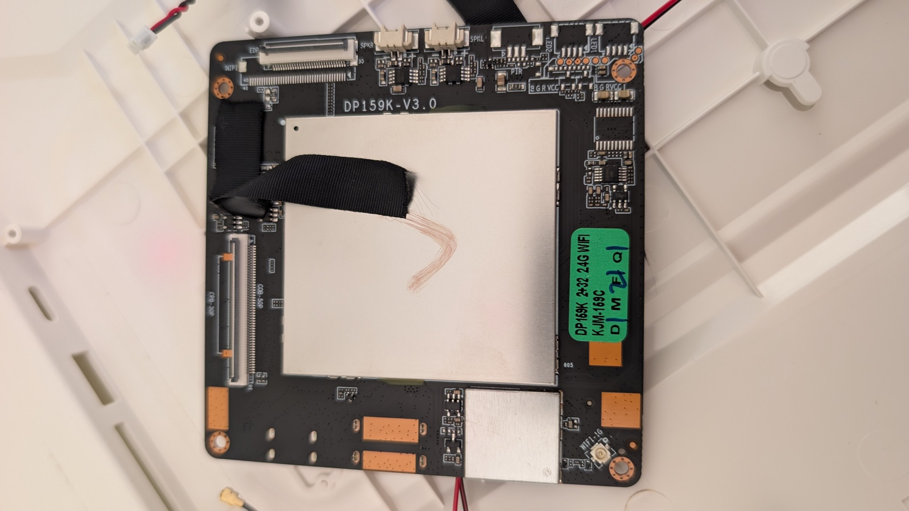
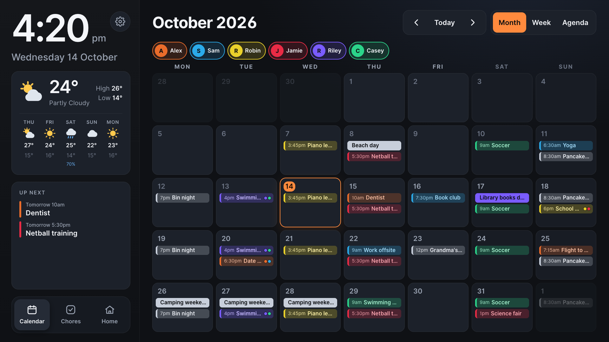
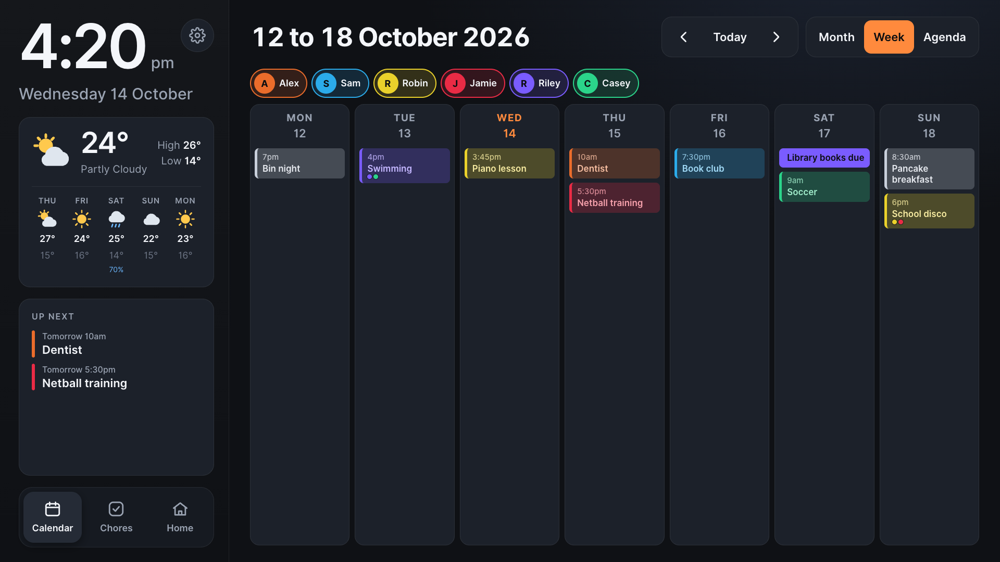
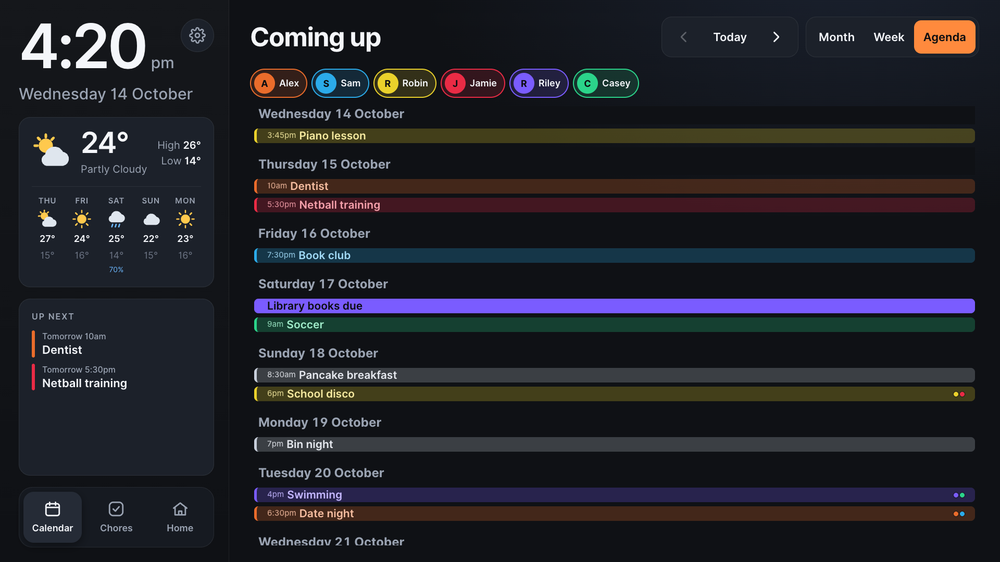
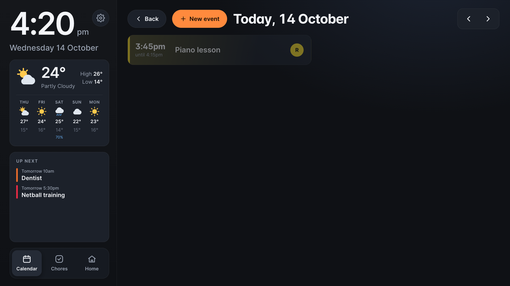
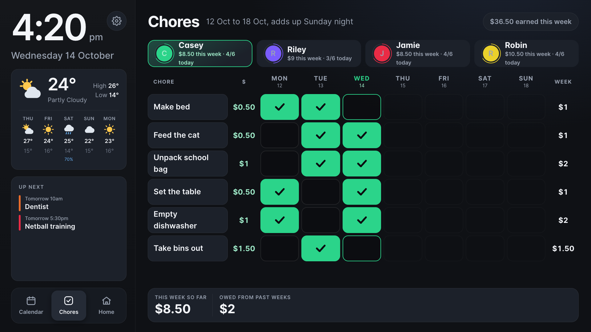
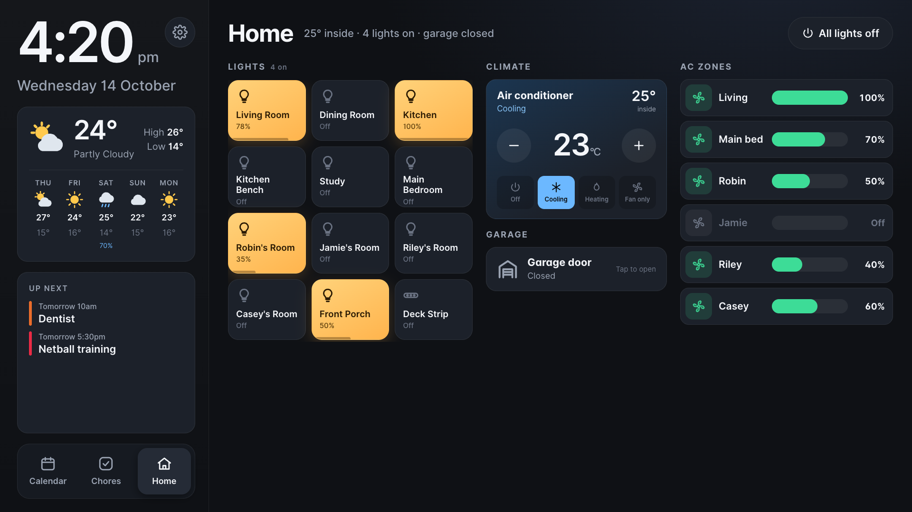
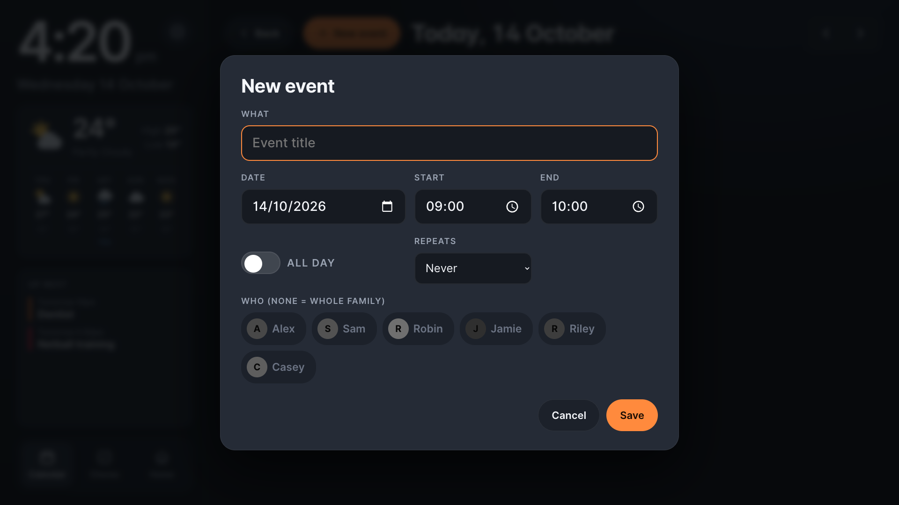
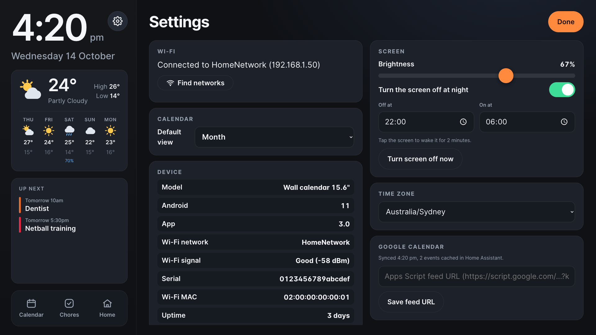

# OpenFramely

[](https://github.com/spaceratz/openframely/actions/workflows/test.yml)
[](LICENSE)
[](ha-integration/custom_components/family_kiosk)

**Free your wall calendar from the cloud.** OpenFramely replaces the stock software on the Whale Framely (Zeasn) 15.6" family wall calendar with a local-first kiosk served by your own Home Assistant. Everything stays on your LAN, with no vendor account, subscription, or telemetry. Your calendar, chore chart, lights and air conditioning run on the wall you already own.


## The hardware

A 15.6" 1920x1080 IPS touchscreen family calendar in a white frame, sold in Australia and elsewhere under a few brand names that all run the Zeasn "Whale Framely" app. Inside it's a small Android board:

| | |
|---|---|
| Board | `DP159K-V3.0` (sticker: "DP159K 2+32 2.4G WIFI") |
| Model string | `BPSDC01` |
| SoC | Rockchip RK3326 / PX30, quad Cortex-A35 |
| Memory | 2 GB RAM, 32 GB eMMC |
| OS | Android 11, launcher `com.zeasn.android.photo.pro` |
| Display / touch | 15.6" 1920x1080 eDP panel (XCX-NV156FHM-N4Z Q5), gslX680 touch controller. Glass 364 x 214 x 5 mm with an 11 mm dead border (no image, no touch), so 342 x 192 mm visible; 10 mm of cables and backlight driver below the glass |
| Other | 2.4 GHz Wi-Fi, stereo speakers, PIR motion sensor header, USB-C, USB-A, SD slot, UART and recovery pads |

If your unit boots to a Zeasn "Framely" calendar and `adb shell getprop ro.product.model` (once you have adb) says `BPSDC01`, this project is written for it.

| Inside the case | Component side | Underside pads |
|---|---|---|
|  |  |  |

## Screenshots

All screenshots use made-up demo data (`kiosk/tools/shots.py` renders them against a fake Home Assistant).

| | |
|---|---|
|  **Month**: colour per person, tap a day for detail |  **Week**: seven columns, start and end dates in the title |
|  **Agenda**: what's coming up, two weeks per page |  **Day**: everything on one day, add events on the wall |
|  **Chores**: tick-only money chart per kid, weekly totals |  **Home**: lights, master AC, damper zones, garage door |
|  **Event editor**: who, when, repeats, on-screen |  **Settings**: Wi-Fi, screen, time zone, device info |

Night mode dims the screen after sunset and further late at night; a tap wakes it for two minutes.

## Why

The stock software phones home to `whalephoto.zeasn.tv` and `saas.zeasn.tv`, syncs your family's schedule through their servers, and needs their cloud (and their business) to keep working. We have all bought cheap hardware that dies when the vendor's servers do. OpenFramely keeps the hardware and throws away the dependency:

- **Family calendar** on the wall: month, week, agenda and day views (default view set on the wall), per-person colours (tag Google events like `Riley, Casey: Swimming`, or `Everyone: Beach day` for the whole family, which shows in neutral white; a few people get coloured dots), editing on the wall, optional one-way sync *from* a Google Calendar (pulled by Home Assistant, cached locally).
- **Chore money chart**: each kid gets a Mon-Sun grid of chores with a dollar value; one tick per chore per day; the week totals itself and rolls into a running "owed" balance. The wall is tick-only: paying out and editing chores happens from Home Assistant, and every tick/untick is logged so you can see who changed what.
- **Home controls**: lights (with an "all off" button), a climate card, per-room AC damper zones (on/off and open %), and the garage door (with "Opening..." feedback), all live both directions.
- **Made for a family wall**: progress rings and a little confetti when a kid finishes every chore for the day, a clear banner if Home Assistant goes away, and after 3 idle minutes it tidies itself back to the calendar.
- **Offline-first**: the wall talks to Home Assistant on your LAN (a local DNS entry points the hostname at HA's LAN address). Calendar, chores and controls keep working when the internet is down.
- **On-device settings**: Wi-Fi, brightness, night sleep with tap-to-wake, timezone and a device info card (model, build, network and signal), with no PC needed.
- **Own your data**: Home Assistant stores all state locally, and exposes a subscribable ICS feed for Thunderbird and phone calendars.

## What's in this repo

| Path | Purpose |
|---|---|
| `kiosk/web/` | Wall app (plain HTML/CSS/JS, no build step, no CDNs, bundled fonts) |
| `kiosk/android/` | Launcher APK source + `build.sh` (WebView kiosk, device settings) |
| `kiosk/google/Code.gs` | Optional Google Calendar feed (Apps Script web app) |
| `ha-integration/custom_components/family_kiosk/` | Home Assistant backend (events store, Google cache, chore money, ICS) |
| `docs/board-photos/` | Photos of the board, pads and connectors |
| `kiosk/screenshots/`, `kiosk/tools/demo/` | README screenshots and the fake Home Assistant used to render them |
| `docs/AGENT-GUIDE.md` | Step-by-step install guide for an AI agent or a human |
| `docs/DEVELOPMENT.md` | Deploying changes, key files and WebView gotchas |
| `tools/` | Rockchip flash, dump and UART tools |

## Quick start (the short version)

Full detail in `docs/AGENT-GUIDE.md`. You will need: a UART adapter (3.3 V), a USB-A to USB-C data cable, a USB-SD/eMMC reader, and Home Assistant with HTTPS.

1. **Back up the whole eMMC** via the board's FIQ console (`fiq` over 1500000 baud UART, then `reboot ums`) before touching anything. The bootloader on this board is unlocked, but a backup is your revert path.
2. **Enable ADB** with three small eMMC patches (`ro.adb.secure=0`, `persist.sys.usb.config=mtp,adb`, `service.adb.tcp.port=5555`) and an init rc that starts adbd. The patch procedure is in `docs/AGENT-GUIDE.md`; sector locations change between firmware builds, so find them in your own dump.
3. **Install Home Assistant bits**: copy `family_kiosk` to `/config/custom_components/`, add `family_kiosk:` to `configuration.yaml`, copy `kiosk/web/` to `/config/www/kiosk/`, restart HA once.
4. **Build + install the APK**: `kiosk/android/build.sh install` (needs Android build tools). The APK wraps a WebView pointed at your HA URL and stores your HA token in private app storage via adb, keeping tokens out of web files.
5. **Set it as HOME** so the wall boots into the kiosk, and block the vendor domains at your router.
6. Optional: local DNS so the HA hostname resolves to its LAN address, your router as NTP server, and the Google Apps Script feed for near-real-time calendar sync.

## Development

```sh
cd kiosk && bun run test                      # 46 unit tests for the wall app (web/lib.js, web/tags.js)
pip install -r requirements-dev.txt
python -m playwright install chromium
python -m pytest                              # 22 Home Assistant logic tests + 23 browser tests
ruff check ha-integration kiosk/tests kiosk/tools
python kiosk/tools/shots.py                   # regenerate the README screenshots (demo data only)
```

Lighthouse (via [Chrome DevTools MCP](https://github.com/ChromeDevTools/chrome-devtools-mcp), demo data only) scores **100** for Accessibility, Best Practices, SEO and Agentic Browsing on every screen. With the CPU slowed 8x to approximate the wall's processor, page load LCP is ~0.35 s, CLS 0.01 and tap response (INP) ~115 ms, all in the "good" range.

The browser tests load the real wall page against a fake Home Assistant (`kiosk/tools/demo/mock.js`) at 1920x1080 and fail on JS errors, anything off screen, cut-off tile text, or a wrong service call. CI runs everything on every push (`.github/workflows/test.yml`).

## Safety

- Take a full eMMC backup with SHA256s before every write, and never run an erase command without a backup and a reason.
- The vendor's cloud API has security flaws. You do not need to touch it; the legacy exporter only reads your own device's data.
- This project has no affiliation with Zeasn, Whale Framely or any retailer or brand selling this hardware. Modifying your unit may void its warranty.

## Contributing

Pull requests are welcome. Read [CONTRIBUTING.md](CONTRIBUTING.md) first (setup, tests, the no-personal-data rule), and please follow the [Code of Conduct](CODE_OF_CONDUCT.md). Security issues go through [SECURITY.md](SECURITY.md), not public issues.

## License

MIT. See `LICENSE`. Vendor trademarks belong to their owners.