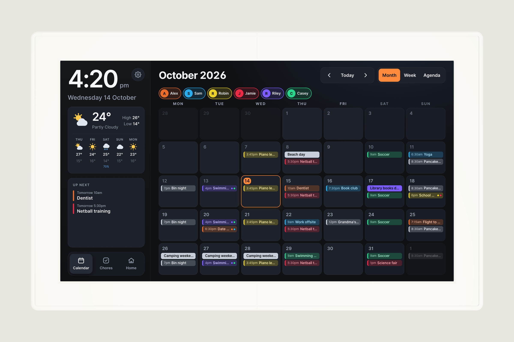

# Wall enclosure

A 3D-printed frame that mounts the bare 15.6" panel and board flush on a wall over a power point,
with the 5 V supply in the wall cavity. Parametric, built with
[text-to-cad](https://github.com/earthtojake/text-to-cad) (cadgen / build123d).



## Build it

```sh
./run.sh render       # every part, STLs, drawings, BOM, assembly guide, checks and renders/*.png
checks/presets.sh     # build and check every preset combination in a scratch copy
```

Needs [uv](https://docs.astral.sh/uv/) (cadgen runs through `uvx`) and ImageMagick for the composite renders.

## What it is

- **392 x 242 mm, 21.6 mm off the wall**, even 25.2 mm bezel, for the 15.6" panel.
- **Screen:** glass 364 x 214 x 5 mm, plus 10 mm of cables and backlight driver below it. The glass
  has an 11 mm dead border all round (no image, no touch), so the visible window is 342 x 192 mm.
  The lip hides 21 mm at the bottom and 11 mm at the top and sides.
- **Back plate** sits flat on the wall, clamped by a **saddle** that uses the power point's own two
  screws (84 mm centres, Clipsal 2032VH / 2025-WE datasheets). The saddle bars rest on the grid's
  screw ears, so the screws go up from 25 to 30 mm.
- The **5 V lead** comes up through the empty grid (socket mechanism removed by an electrician),
  out a notch in the saddle, along the plate under two printed clips, to the board's USB-C.
- The **board** screws to standoffs on the plate, connector side to the wall, so SD and USB stay reachable.
- **No screws in the enclosure itself.** Only the wall (the power point's two screws) and the board
  (four into its standoffs) are screwed.
- The **panel** sits behind the bezel lip with a 10 mm gap above it, held by 6 clamp bars on foam
  tape. Each bar has two printed snap hooks that click out through slots in the frame wall and sit
  flush; press the barbs in from outside to release one.
- The **frame** hangs on hooks along the top (lift on, drop down) and two **snap latches** on the
  bottom click as it drops. To service: lift firmly 8 mm, pull the frame off. The back plate, board and
  lead stay on the wall.
- The frame prints as **two halves** (it is 392 mm wide), joined by snap-in joiners and lip splices
  and glued; the seam is a V-groove.

| Render | Shows |
|---|---|
| `renders/on-wall.png` | on the wall with the calendar on screen (demo data) |
| `renders/exploded.png` | every part in fitting order |
| `renders/back.png` | inside: back plate, saddle, 5 V lead (blue), board, speakers |
| `renders/section-gpo.png` | cut through the power point showing the depth stack |
| `renders/service.png` | frame lifted off for servicing |
| `renders/print-beds.png` | each part as it sits on the print bed |
| `renders/colours.png` | white, warm grey, charcoal and oak-tone filament |

## Print it

Every STL is already in print orientation and fits a 256 mm bed (largest part 238 x 242 mm).
About 384 g of PETG or ASA at 0.2 mm, 3 walls, 20% gyroid, roughly 9 h. Print `STL/coupons.stl`
first: seven small fit-test pieces (corner, hook, bottom latch, snap hook), under an hour. Full print list and hardware in
`BOM.md`; fitting steps in `ASSEMBLY.md`.

## Pick your hardware

Edit `src/preset.json`:

| Key | Values |
|---|---|
| `panel` | `framely-15.6` (default), `generic-13.3`, `generic-17.3`, or add your own in `src/params.py` |
| `gpo` | `clipsal-2000` (AU/NZ, 84 mm screws), `uk-single` (60.3 mm) |
| `mech` | `removed` (supply in the wall, 21.6 mm deep) or `plug` (plug pack in a socket, 37.5 mm) |
| `gpo_x` | GPO left/right of the calendar's centre (default -30: the wall box is 30 mm left) |
| `gpo_y` | GPO height from the calendar's centre, -25 to +35 mm (wall box 30 mm left) |
| `win_dx`, `win_dy` | where the visible screen sits on the panel, if not centred (mm, + = right / up) |
| `bezel` | `even` (same border all round) or `tight` (smallest outline) |
| `plate_split` | `true` to print the back plate in two for 250 x 210 beds |
| `colour`, `logo`, `corner_r` | looks |

Values that are best guesses are marked `ASSUMPTION` in `src/params.py`; `BRIEF.md` lists them
with the requirements and sources behind every dimension.

## Files in this directory

| Path | Purpose |
|---|---|
| `BRIEF.md` | Design requirements, sources and assumptions |
| `BOM.md` | Print list (size on the bed, support %, grams), hardware, compatible printers |
| `ASSEMBLY.md` | Fitting and servicing steps |
| `STL/` | Print-ready STLs in print orientation; print `coupons.stl` first |
| `PDF/` | Dimensioned drawings (the saddle drawing is 1:1) |
| `wall-template.svg` | 1:1 template to tape over the power point |
| `checks/` | Fit, interference, service-lift, printability (DfAM), strength, heat and touch checks |
